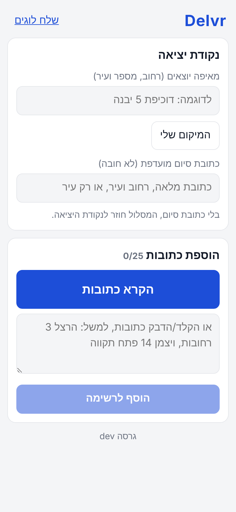
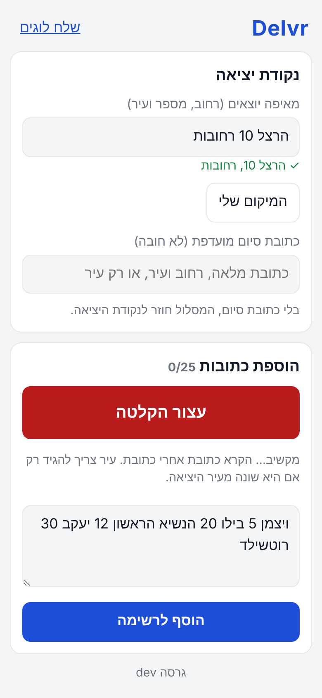
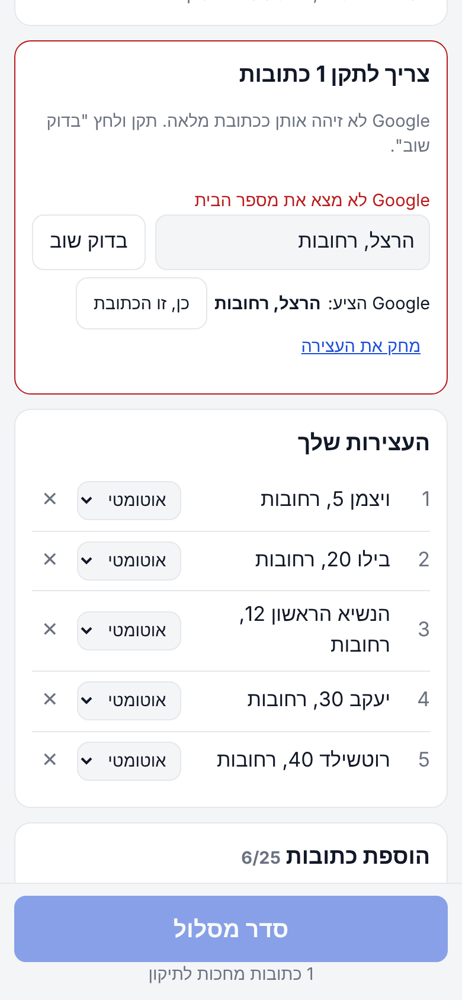
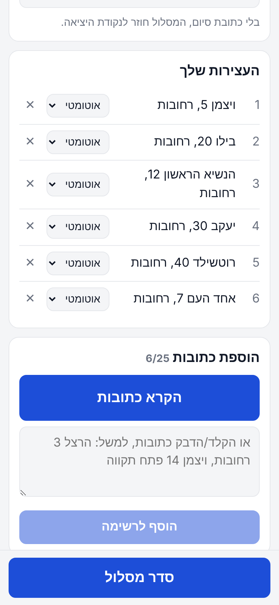
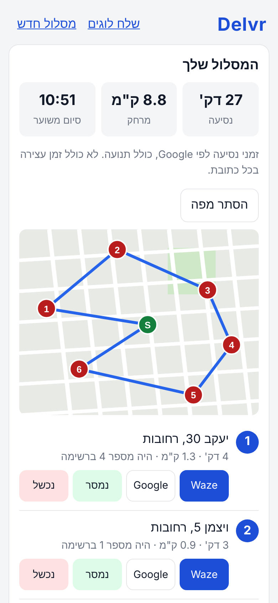
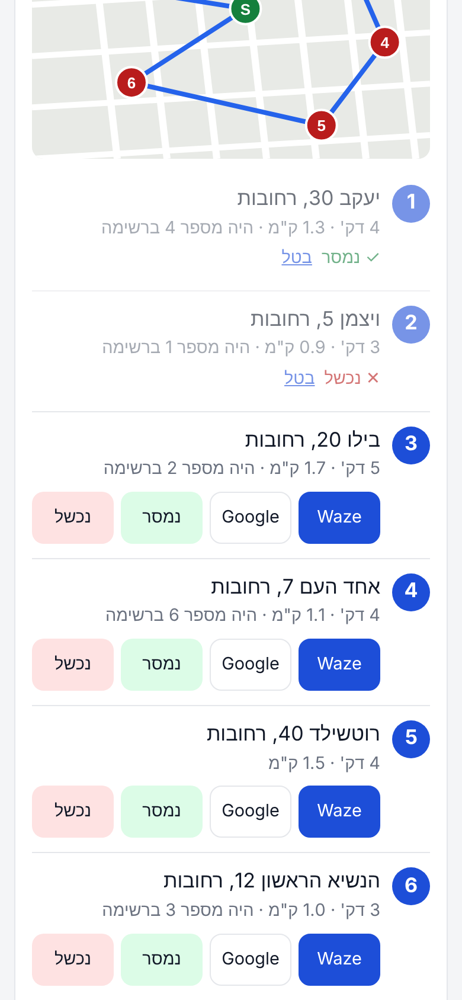

# Delvr: מה זה ואיך משתמשים

Delvr היא אפליקציית ווב לשליחים. מקריאים או מדביקים רשימת כתובות בעברית, האפליקציה מאמתת כל כתובת מול Google, ומחזירה את סדר הנסיעה הכי מהיר לפי זמני הנסיעה של Google, כולל תנועה. מכל עצירה יוצאים לניווט ב-Waze בלחיצה אחת.

היא נפתחת בדפדפן של הטלפון ואפשר להתקין אותה למסך הבית. אין הרשמה ואין שרת נתונים: המסלול נשמר רק בטלפון.

להתקנה עם מפתח Google משלך: [SETUP.md](SETUP.md).

> הצילומים צולמו עם נתוני דמו מרחובות. המפה בצילומים היא איור פשוט במקום מפת Google האמיתית, והזמנים והמרחקים מומצאים.

---

## 1. נקודת יציאה

- כותבים מאיפה יוצאים (רחוב, מספר ועיר) ולוחצים **אמת**, או לוחצים **המיקום שלי**.
- כתובת סיום מועדפת היא לא חובה. בלעדיה המסלול חוזר לנקודת היציאה. אפשר לכתוב כתובת מלאה, רחוב ועיר, או רק עיר.
- העיר של נקודת היציאה היא ברירת המחדל לכל הכתובות. לא צריך להגיד "רחובות" בכל כתובת.

## 2. הקראת כתובות

- **הקרא כתובות** ומקריאים אחת אחרי השנייה, בלי לעצור. עיר אומרים רק אם היא שונה מעיר היציאה.
- הטקסט מופיע בתיבה תוך כדי. אפשר לתקן אותו ידנית לפני ההוספה.
- במקום להקריא, אפשר להקליד או להדביק רשימה (למשל מוואטסאפ).
- **הוסף לרשימה** מפרק את הטקסט לכתובות נפרדות. כתובת שכבר ברשימה לא נוספת שוב.

ההקלטה עובדת ב-Chrome. בדפדפנים אחרים יש רק הקלדה.

## 3. כתובת ש-Google לא זיהה

כל כתובת נבדקת מול Google. כתובת שחסר בה מספר בית, ש-Google לא בטוח לגביה, או שנמצאה בעיר אחרת ממה שנאמר, עוברת לכרטיס האדום **צריך לתקן**. שם אפשר:
- לתקן את הטקסט וללחוץ **בדוק שוב**.
- לאשר את מה ש-Google הציע (**כן, זו הכתובת**).
- למחוק את העצירה.

כל עוד יש כתובת לתיקון, הכפתור "סדר מסלול" נעול. כל כתובת שאומתה, כולל תיקון שאישרת, נשמרת בטלפון ל-30 יום. בפעם הבאה שתקריא אותה כתובת היא תזוהה מיד, בלי לפנות ל-Google.

## 4. רשימת העצירות

- כל העצירות מופיעות בנוסח של Google, בעברית.
- ליד כל עצירה יש בורר: **אוטומטי** (ברירת המחדל), **ראשונה** או **אחרונה**. משתמשים בזה למשלוח דחוף או לאיסוף שחייב להיות בסוף.
- ✕ מוחק עצירה.
- עד 25 עצירות במסלול.
- **סדר מסלול** שולח את הכול ל-Google ומחזיר את הסדר המהיר.

## 5. המסלול

- למעלה: זמן הנסיעה הכולל, המרחק ושעת הסיום המשוערת. הזמנים כוללים תנועה, אבל לא את הזמן שאתה עומד בכל כתובת.
- **הצג מפה** פותח מפה עם נקודת היציאה (S) והעצירות לפי הסדר. המפה מוסתרת כברירת מחדל, כי כל פתיחה שלה נספרת אצל Google כטעינה.
- ליד כל עצירה: כמה זמן ומרחק מהעצירה הקודמת, ואיזה מספר היא הייתה ברשימה המקורית.
- **Waze** פותח ניווט ישר לכתובת. **Google** פותח ניווט ב-Google Maps.

## 6. תוך כדי חלוקה

- אחרי כל עצירה: **נמסר** או **נכשל**. העצירה מתעמעמת, ו**בטל** מחזיר אותה.
- **סדר מחדש את מה שנשאר** מחשב מסלול חדש רק לעצירות שעוד לא טופלו, ומתחיל מהעצירה האחרונה שסימנת, כי שם אתה נמצא. שימושי אחרי עיכוב או שינוי בתוכנית.
- **מסלול חדש** (למעלה) מוחק את העצירות ושומר את נקודות היציאה והסיום.
- **שלח לוגים** משתף קובץ עם כל מה שקרה, לצורך דיווח על תקלה.

---

## מה קורה מאחורי הקלעים

| שלב | מי עושה את זה |
|---|---|
| הבנת ההקראה ופירוק לכתובות | קוד בטלפון (`src/domain/parser.js`) |
| אימות כתובת והמרה לנקודה במפה | Google Geocoding, דרך מפתח הדפדפן |
| סדר הנסיעה וזמני נסיעה עם תנועה | Google Routes API, דרך פונקציית שרת ב-Vercel עם מפתח שלא נחשף |
| שמירת המסלול ותיקונים | IndexedDB בטלפון |
| ניווט | קישור ל-Waze או ל-Google Maps |

## מגבלות

- עד 25 עצירות.
- רק כתובות בישראל.
- אין חלונות זמן ("עד 12:00"), דירה או קומה.
- אין סנכרון בין מכשירים.
